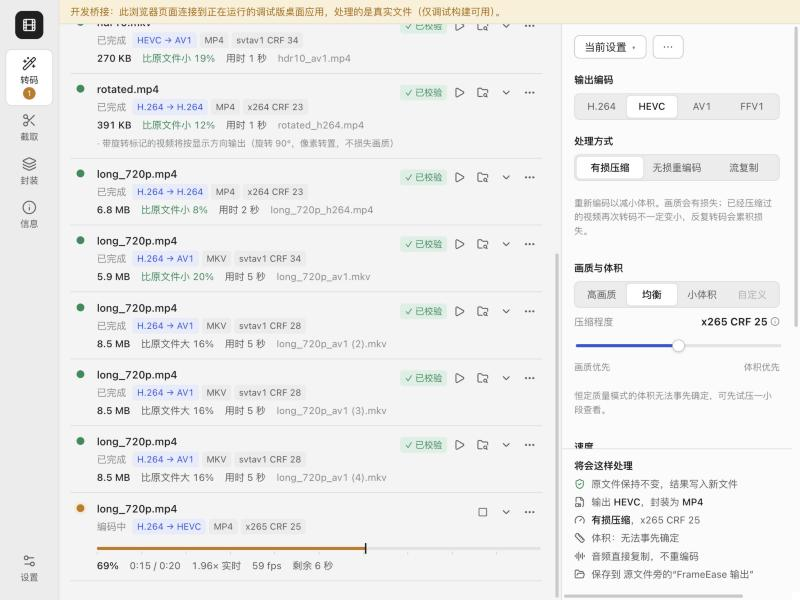
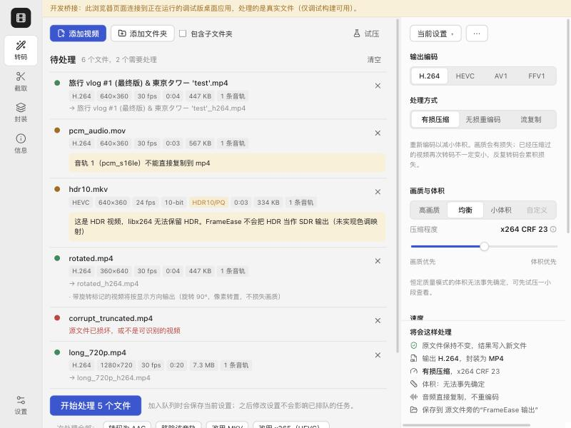
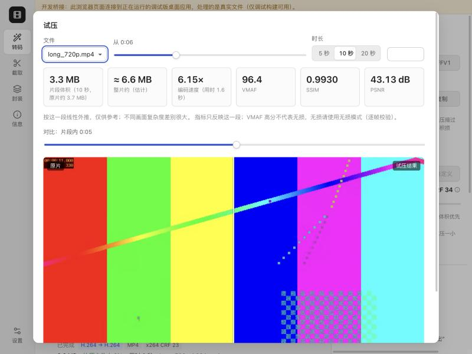
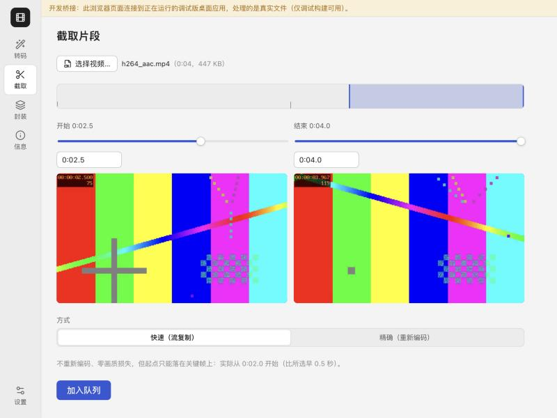
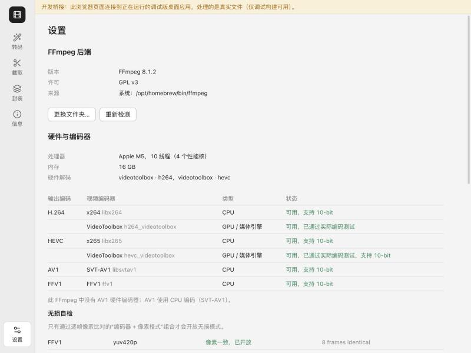

<p align="center">
  
</p>

<h1 align="center">FrameEase</h1>

<p align="center"><strong>Local video compression and transcoding</strong><br>H.264 / HEVC / AV1 compression, frame-verified lossless re-encoding and batch queues, all on your own computer.</p>

<p align="center"><a href="README.md">简体中文</a> · <strong>English</strong></p>

<p align="center">
  <a href="https://github.com/MarkYang44/FrameEase/releases/latest"></a>
  
  
  
  <a href="https://github.com/MarkYang44/FrameEase/actions/workflows/build.yml"></a>
</p>

FrameEase is a desktop tool for compressing, transcoding and batch-processing video locally. It aims to be a more dependable take on the classic Chinese encoding toolboxes: the output format you choose is never silently swapped, lossless means pixel-identical frame by frame, one broken file or a results CSV locked by Excel never stops the queue, and source files are never overwritten. The interface is built with Tauri 2 and React; the work is done by FFmpeg 8.1, which ships with the installers.

**Ready to use: the Windows 10/11 (x64) and macOS (Apple Silicon) installers include FFmpeg, with nothing else to install and no PATH to configure.** The interface is Chinese-first; English currently covers only part of the app shell.

[Download](#download-and-install) · [Features](#features) · [Troubleshooting](#troubleshooting) · [Build from source](#build-from-source) · [Architecture (Chinese)](docs/ARCHITECTURE.md) · [Test record (Chinese)](docs/TESTING.md) · [Report an issue](https://github.com/MarkYang44/FrameEase/issues)

## See it in action

**Conversion queue · Live progress**

Each job shows the conversion, the actual encoder settings, the size change and the verification result. A running job shows progress, speed relative to real time, frame rate and time remaining. The panel on the right summarizes what the current settings will actually do.



<details>
<summary><strong>Import checks · Conflicts flagged before you start</strong></summary>

Every file is probed on import. HDR that the chosen encoder cannot keep, an audio track that cannot be copied into the target container, or a damaged source is flagged before processing starts, with one-click fixes.



</details>

<details>
<summary><strong>Trial encode · See the result before committing</strong></summary>

Encode a short segment for real to get an extrapolated file size, encoding speed and VMAF / SSIM / PSNR, then drag a slider to compare source and result.



</details>

<details>
<summary><strong>Trim · Fast keyframe cuts and exact cuts</strong></summary>

Fast mode copies streams without quality loss and tells you which keyframe the cut actually starts on; exact mode re-encodes.



</details>

<details>
<summary><strong>Settings · Capabilities tested for real</strong></summary>

The FFmpeg version, license and source, and for every encoder whether it is available, whether it passed a real test encode and whether it supports 10-bit.



</details>

The screenshots come from the development bridge: a browser page connected to a running debug build, with real FFmpeg processing synthetic clips generated by `scripts/gen-test-media.sh`. No personal video is shown. The pages are rendered by Chromium and may differ slightly from the native window.

## Features

| Module | Capabilities |
| --- | --- |
| Lossy compression | Convert between H.264, HEVC and AV1; High quality / Balanced / Small file plus a 0–100 compression level, mapped to each encoder's own CRF / CQ / q:v and shown as the actual value; target bitrate, target size and two-pass encoding |
| Lossless re-encoding | Only encoder + pixel format combinations that pass a start-up self-test (frame-by-frame pixel hashes) are offered; each finished job is compared with the source frame by frame and fails on any difference; FFV1 archiving; CRF 0 does not count as lossless |
| Faithful output | Resolution and frame rate kept by default (variable frame rate included); HDR is never output as SDR, 10-bit never drops to 8-bit, 4:4:4 never drops to 4:2:0; unsupported combinations are refused with suggested fixes |
| Audio and subtitles | Copy audio (verified by data hash afterwards), convert to AAC / Opus / MP3 / FLAC, or remove it; keep subtitles, add external subtitle files as soft tracks, or burn subtitles into the picture |
| Batch queue | Add files, multiple selections, drag and drop, or folders; each job keeps its own settings snapshot; reorder, pause, cancel and retry; the queue is restored after a restart |
| Hardware acceleration | Apple VideoToolbox, NVIDIA NVENC, Intel Quick Sync, AMD AMF; an encoder is enabled only after a real test encode succeeds; CPU encodes are queued separately from GPU encodes and stream copies |
| Tools | Trial encodes with quality metrics, fast keyframe trims and exact trims, remuxing and track extraction, media information, presets (built-in, save, import, export) |

CPU encodes cap the threads each job uses (x264 `-threads`, x265 `pools`, SVT-AV1 `lp`), and the next job starts only when memory and disk space allow. With the default "automatic" setting, one CPU encode runs at a time.

## Download and install

### 1. Choose an installer

Download the installer for your system from [Releases](https://github.com/MarkYang44/FrameEase/releases/latest). The `SHA256SUMS.txt` file on the same page lets you verify each download.

| System | Installer | Notes |
| --- | --- | --- |
| Windows 10/11 x64 | `FrameEase_<version>_x64-setup.exe` (recommended) | Installs for the current user; no administrator rights needed |
| Windows 10/11 x64 | `FrameEase_<version>_x64_en-US.msi` | For per-machine deployment; installing requires administrator rights |
| macOS · Apple Silicon | `FrameEase_<version>_aarch64.dmg` | Requires macOS 15 or later; open it and drag FrameEase into Applications |

There is no Intel Mac build yet: Homebrew no longer publishes FFmpeg builds for Intel Macs, so there is no FFmpeg to ship with it.

### 2. First launch

The installers are not signed with a paid developer certificate, so the system blocks the first launch:

- **macOS:** open the app once; when macOS says it cannot verify it, go to System Settings → Privacy & Security and click "Open Anyway" near the bottom. If macOS reports the app as damaged, run `xattr -dr com.apple.quarantine /Applications/FrameEase.app` in Terminal, then open it again.
- **Windows:** if "Windows protected your PC" appears, click "More info → Run anyway". On systems without the WebView2 runtime (some Windows 10 installations), the installer downloads it and shows its installer; this needs an internet connection.

### 3. Get started

1. Drag videos into the window, or click 添加视频 / 添加文件夹 (Add videos / Add folder).
2. On the right, choose the output codec and the processing mode (lossy compression, lossless re-encoding or stream copy), and check the summary of what will happen.
3. Click 开始处理 (Start). Results go to a `FrameEase 输出` folder next to each source file by default; the source files are left unchanged.

> Not sure about the compression level? Run a trial encode (试压) on a short segment first and check the size estimate and quality metrics before processing the whole file.

## Output and file safety

- **Sources are never touched:** FrameEase writes only to temporary files named after the job, verifies the result, then commits it with an atomic rename that never overwrites. An output path equal to the source is refused, and name clashes become `name (2).mp4` or are skipped, as you choose.
- **Verified against the actual result:** the output is probed again for codec, resolution, pixel format, rotation, color and HDR metadata, frame count, duration, and audio / subtitle tracks; copied tracks are compared by data hash and the whole file is decoded once. Any mismatch fails the job; file extensions are never trusted.
- **One job cannot sink the queue:** broken files, backend crashes and failed verifications affect only their own job. A stalled backend (no progress for 5 minutes) is stopped and retried once with the same settings. If the results CSV is locked, records are held and written later.
- **Disk space and exit protection:** free space is checked before a job starts, and a job stops if space runs out while encoding. Closing the app while jobs are running asks first.
- **Restart recovery:** finished and verified jobs are not run again; interrupted jobs start over from the beginning (resuming mid-file is not claimed).

## Data and privacy

| Location | Contents |
| --- | --- |
| `FrameEase 输出` next to the source, or a custom folder | Output videos |
| App data folder | Queue `queue.json`, settings `config.json`, presets `presets.json`, capability cache `capabilities.json`, results log `FrameEase 结果记录.csv` |
| `logs/` in the app data folder | FFmpeg log of each job, kept for 30 days |
| App cache folder | Temporary encode folders `work/` and preview frames `previews/`, cleared at start-up |

The app data folder is `~/Library/Application Support/com.frameease.desktop/` on macOS and `%APPDATA%\com.frameease.desktop\` on Windows; the cache folder is `~/Library/Caches/com.frameease.desktop/` and `%LOCALAPPDATA%\com.frameease.desktop\` respectively.

FrameEase needs no account, uploads no files and collects no usage data; all processing is done by FFmpeg on your computer.

## Platform and verification status

| Platform | Status |
| --- | --- |
| macOS · Apple Silicon | Developed and tested on macOS 27 (M5): all 164 Rust tests pass (30 of them run real FFmpeg or real child processes), the end-to-end suite passed 15 consecutive stress runs, and the desktop app has been run for real. |
| Windows 10/11 x64 | Not yet verified on a physical Windows PC. On GitHub Actions' Windows Server 2025 runners the core tests (including Excel-style exclusive file locks, Chinese / Japanese / special-character paths, cancellation and restart recovery) and NSIS / MSI packaging pass, and both installers are unpacked to check the bundled FFmpeg. |
| macOS · Intel | Not available: there is no Intel FFmpeg build to ship (see above). The code makes no platform assumptions. |

See [docs/TESTING.md](docs/TESTING.md) (Chinese) for the full test scope, the problems found and fixed, and what is not yet covered.

## Known limitations

- The Homebrew FFmpeg in the macOS build has no libass / libaom / rav1e: **burning in text subtitles is unavailable** (the interface explains why; image-based subtitles can be burned in), and AV1 uses SVT-AV1 only. The BtbN build shipped for Windows includes these libraries, but those features have not been tested yet.
- Apple platforms have no AV1 hardware encoder, so that GPU option is disabled. NVENC, Quick Sync and AMF are enabled only after a real test encode passes and have not yet been verified on real graphics hardware.
- HDR: lossy re-encoding allows only x265 and SVT-AV1 (HDR10 metadata verified to be preserved); there is no HDR → SDR tone mapping; Dolby Vision dynamic metadata is lost (after asking you), and Profile 5 is refused.
- Restarted jobs encode from the beginning; fast trims can only start on a keyframe (no "smart cut").
- SVT-AV1 4.1 occasionally deadlocks internally under heavy parallel load (an encoder-library issue). FrameEase sets its parallelism explicitly, detects stalls and retries once; with default settings this is rare but cannot be ruled out.
- Trial-encode size estimates and quality metrics describe only the chosen segment.
- The English interface currently covers only part of the shell; the rest falls back to Chinese.

## Troubleshooting

| Problem | Suggested action |
| --- | --- |
| macOS says the app cannot be verified or is damaged | Follow [First launch](#2-first-launch); this happens because the app is not signed with a paid developer certificate |
| Windows SmartScreen blocks the installer | Click "More info → Run anyway" |
| The app cannot find FFmpeg or reports a backend error | Check that security software has not quarantined the `ffmpeg` folder in the install directory; or choose a folder containing both ffmpeg and ffprobe under Settings (设置) → FFmpeg backend → 更换文件夹… (Change folder) |
| An encoder or GPU option cannot be selected | It did not pass a real test encode (hardware, driver or FFmpeg support is missing); after updating drivers, click 重新检测 (Detect again) in Settings |
| A job stays at 需要处理 (Needs attention) | The settings conflict with the source (for example HDR to H.264, or audio that cannot be copied into MP4); use the fix offered on the job, or the suggested container |
| Does the queue stop if Excel has the results CSV open? | No. Records are held and written once Excel closes the file |
| Keeping the original quality exactly | Use lossless re-encoding (verified frame by frame) or stream copy (no re-encoding, container change only) |

## Build from source

### 1. Prepare your environment

| Dependency | Purpose |
| --- | --- |
| Node.js 20+ | Build the interface |
| Rust stable ([rustup](https://rustup.rs/)) | Build the core and the app shell |
| Xcode Command Line Tools (macOS) / MSVC build tools and WebView2 (Windows) | Native compilation |
| FFmpeg 8.1 | The processing backend shipped with the app; see the next step |

### 2. Get the source and FFmpeg

```bash
git clone https://github.com/MarkYang44/FrameEase.git
cd FrameEase
npm install
```

Put FFmpeg into the app's resource folder, `src-tauri/resources/ffmpeg`:

```bash
# macOS: copy Homebrew's ffmpeg@8 and its libraries, rewritten to load from relative paths
brew install ffmpeg@8
npm run ffmpeg:bundle -- "$(brew --prefix ffmpeg@8)/bin"
```

```powershell
# Windows: download BtbN's shared GPL build of FFmpeg 8.1
pwsh ./scripts/fetch-ffmpeg-windows.ps1
```

During development, if the resource folder has no FFmpeg, the app looks for one on the system (Homebrew, for example).

### 3. Run, test and package

```bash
npm run app:dev      # run in development
npm run core:test    # core tests (synthetic clips are generated in test-media/; no personal video is read)
npm run app:build    # package: .app / .dmg on macOS, NSIS / MSI on Windows
```

The installers are written to `target/release/bundle/`.

### About the bundled FFmpeg

- **The bundled FFmpeg sets the minimum OS version.** The app itself needs only macOS 11 / Windows 10, but Homebrew builds FFmpeg for the macOS version it runs on: packaging on macOS 26 requires 26.0+, while CI packages on `macos-15` and requires 15.0+. The packaging script records the requirement of the bundled libraries; to support older macOS versions, pass any compatible FFmpeg folder to `python3 scripts/bundle_ffmpeg_macos.py <folder>`.
- **Windows uses a shared build.** `ffmpeg.exe` and `ffprobe.exe` ship with FFmpeg's own DLLs in the same folder; x264, x265, SVT-AV1, libaom, dav1d, libass and the other libraries are linked statically into those DLLs, so the codec set ships once (a static build carries it in both programs). Windows loads a program's DLLs from the program's own folder first, and the app starts FFmpeg by full path, so PATH plays no part.
- **License:** the bundled FFmpeg enables GPL components and is distributed under the GPL; the app runs FFmpeg as a separate process and does not link to it.

## Development and verification

| Directory | Responsibility |
| --- | --- |
| `crates/fe-core` | All application logic: probing, capability detection, argument building, the queue and its state machine, output verification, file safety; independent of Tauri and tested on its own |
| `src-tauri` | Tauri shell: command and event bridge, start-up detection (capabilities cached per FFmpeg fingerprint), exit protection |
| `src` | React 19 + TypeScript + Vite interface (zustand, lucide, sonner) |
| `scripts` | FFmpeg packaging, test media generation, third-party license list, CI helpers |
| `.github/workflows/build.yml` | Tests, packaging and releases for macOS and Windows |

Module boundaries, the state machine and the safe commit flow are described in [docs/ARCHITECTURE.md](docs/ARCHITECTURE.md) (Chinese).

CI generates test media, runs all core tests and the type check, and packages the app on `macos-15` (Apple Silicon) and `windows-latest`. On Windows it also unpacks both installers to confirm the bundled FFmpeg is complete and starts from the unpacked folder. Pushing a `v*` version tag publishes these installers with SHA-256 checksums to GitHub Releases.

`npm run app:dev:bridge` starts a debug build with the `dev-bridge` feature and serves commands and events on `127.0.0.1:1430`; open `http://localhost:1420/?bridge` in a browser to drive the real backend from the same interface for automated UI checks. Release builds do not include this feature.

## License and acknowledgments

FrameEase source code is released under the [MIT License](LICENSE). The FFmpeg shipped with the installers is distributed under the GNU GPL v3; licenses of its components and of the Rust / npm dependencies are listed in [docs/THIRD_PARTY_LICENSES.md](docs/THIRD_PARTY_LICENSES.md).

Thanks to [FFmpeg](https://ffmpeg.org/), [x264](https://code.videolan.org/videolan/x264), [x265](https://bitbucket.org/multicoreware/x265_git), [SVT-AV1](https://gitlab.com/AOMediaCodec/SVT-AV1), [dav1d](https://code.videolan.org/videolan/dav1d), [Tauri](https://tauri.app/), [React](https://react.dev/), [Lucide](https://lucide.dev/), and [BtbN/FFmpeg-Builds](https://github.com/BtbN/FFmpeg-Builds) for the Windows FFmpeg builds.

<p align="center">Designed by Mark Yang</p>
