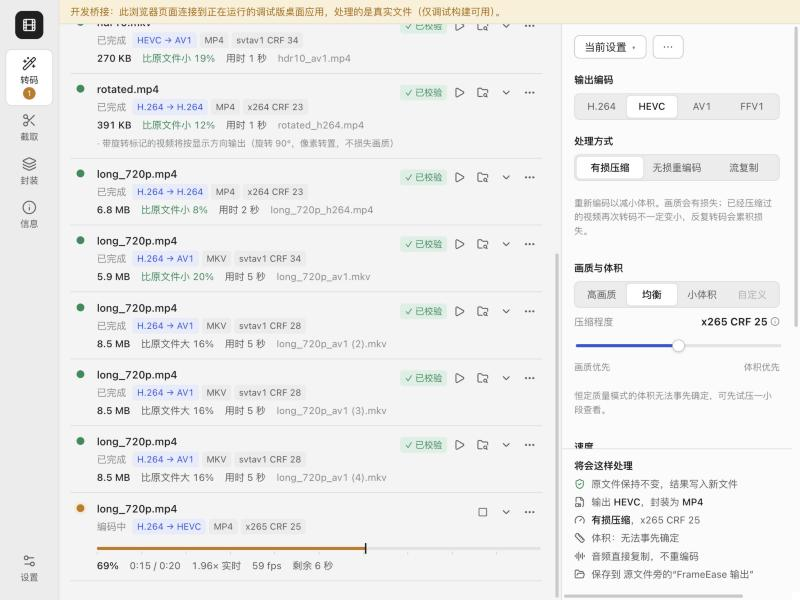

# FrameEase

本机运行的视频压缩、转码与批量处理工具（Windows / macOS）。目标是做一个“接近小丸工具箱、但更可靠”的工具：用户指定的输出格式不会被偷换，无损就是逐帧像素一致，批量队列不会因为某个文件或某个被 Excel 占用的 CSV 而中断，原文件永远不会被覆盖。



## 验证状态（如实说明）

| 平台 | 状态 |
|---|---|
| macOS 27 · Apple Silicon（M5） | **已实机开发与测试**：164 项 Rust 测试全部通过（其中 30 项调用真实 FFmpeg 或真实子进程），端到端套件连续 15 轮压力复测无失败；桌面应用已实际启动运行；界面通过开发桥接连接真实后端验证并截图；已构建 `.app`/`.dmg`（见下方“打包”）。 |
| macOS Intel | **未验证，目前也无法打包**。代码无平台假设，但没有可随包附带的 Intel 版 FFmpeg：Homebrew 已不再为 Intel Mac 提供 FFmpeg 预编译包，所以 CI 暂不构建 Intel 版本（见 [docs/TESTING.md](docs/TESTING.md)）。 |
| Windows 10/11 x64 | **未在实体 Windows 电脑上验证**。GitHub Actions 的 Windows Server 2025 运行器上，核心测试（含 Excel 式文件独占锁回归测试、中文/日文/特殊字符路径、取消与重启恢复）与 NSIS/MSI 打包均已通过；该环境的一次运行暴露了无损自检的并发问题，已修复并补了回归测试。Windows 专用代码：无控制台窗口、Job Object 随应用退出结束子进程、`MoveFileExW` 不覆盖提交。 |

## 已实现

**核心（端到端已打通并测试）**
- 媒体探测：容器/流/像素格式/位深/色度采样/色彩标记/HDR10 与 HLG/母版显示元数据/杜比视界/旋转矩阵/可变帧率（按包时间戳判断）/隔行。
- H.264、HEVC、AV1 相互转换（含 H.264→AV1→H.264 往返）；FFV1 无损存档。
- 有损：高画质/均衡/小体积 + 0–100 压缩程度；按编码器换算成各自的 CRF/CQ/q:v（界面直接显示实际数值并说明“不同编码器数值不可比较”）；目标码率、目标体积、支持时的两遍编码。
- 无损：只开放“编码器 + 像素格式”通过启动自检（逐帧像素哈希比对）的组合；每个无损任务完成后再与原片逐帧比对，不一致即判失败。已验证：x264 `qp 0`、x265 `lossless=1`、SVT-AV1 `lossless=1`、FFV1；**CRF 0 不算无损**，SVT-AV1 遇到 4:4:4 时拒绝而不是悄悄降为 4:2:0。
- 流复制/重新封装作为独立模式；关键帧快速截取与重编码精确截取分开。
- 默认保持分辨率与帧率（含可变帧率，`fps_mode passthrough`）；HDR 不会当 SDR 输出、10-bit 不会悄悄降为 8-bit、4:4:4 不会悄悄降为 4:2:0——不支持的组合会拒绝并给出可点的修正选项。
- 音频：直接复制（完成后数据哈希校验）/转码（AAC、Opus、MP3、FLAC）/不要；音轨选择；无法复制到目标容器时先问用户（转 AAC / 移除该轨 / 改用 MKV），不悄悄改。
- 字幕：保留（MP4 中文字字幕转 mov_text）、外挂软字幕、烧录（图形字幕用 overlay；文字字幕需要带 libass 的 FFmpeg）。
- 批量队列：文件/多选/拖放/文件夹（默认仅当前目录，可选递归，自动排除输出文件夹和临时文件）；每个任务独立设置快照；排序、移除、重试、暂停、取消正在编码的任务；完整状态机（等待/需要处理/探测/编码/封装/校验/完成/取消/失败）；真实进度、速度、fps、剩余时间。
- 持久化：队列原子写入并保留备份；重启后恢复，已完成且已校验的任务不重跑，被中断的任务从头重新处理（不宣称从中途续编）；上次崩溃留下的 ffmpeg 进程与本应用的临时文件会被清理。
- 安全输出：只写入带任务编号的临时文件 → 校验 → 原子“不覆盖”重命名提交；重名自动编号或跳过；禁止输出与源文件同路径；只删除匹配临时文件模式的文件；开始前检查磁盘空间，编码中空间不足会停止该任务。
- 输出校验：按实际探测结果检查编码（不看扩展名）、分辨率、像素格式、旋转、色彩标记、HDR 元数据、帧数、时长、音轨/字幕数量与编码、复制轨道的数据哈希、完整解码。
- 可靠性：单个任务失败（坏文件、后端崩溃、校验失败、甚至内部 panic）不影响队列；后端卡死（进度计数 5 分钟不变）会被结束并以相同设置自动重试一次；结果 CSV 被占用时只暂存记录并稍后补写（回归测试覆盖）；关闭应用时如有任务进行中会询问。
- 资源：CPU 编码与“GPU 编码/流复制”分开排队；每个 CPU 任务限制线程数（x264 `-threads`、x265 `pools`、SVT-AV1 `lp`）；按内存与磁盘约束开始任务；硬件编码器只在实际测试编码通过后才可用，硬件解码同样实测。

**工具**：试压（短片段编码、体积外推、PSNR/SSIM/VMAF、原片/结果滑动对比）、截取（关键帧标记、起止画面预览）、封装合并与轨道提取、媒体信息、预设（内置 + 保存/导入/导出）。

**界面**：中文优先（字典结构可扩展英文）；跟随系统深浅色；键盘可操作、焦点可见；尊重“减少动态效果”；按 Emil Kowalski 的设计工程原则落实动效（只动 transform/opacity、ease-out、按下 0.97、浮层从触发点展开、悬停效果仅限鼠标设备、批量清除用按住确认而不是弹窗）。

## 技术栈

- 外壳：Tauri 2（系统 WebView，安装包小、常驻内存低）
- 核心：Rust（`crates/fe-core`，不依赖 Tauri，可单独测试）
- 界面：React 19 + TypeScript + Vite，状态用 zustand，图标 lucide，提示 sonner
- 后端：FFmpeg 8 / ffprobe，以参数数组启动子进程，从不经过 shell

```
crates/fe-core/src
  media.rs     探测（ffprobe JSON → MediaInfo）
  caps.rs      能力检测：编码器、像素格式、硬件编码/解码实测、无损自检
  encoders.rs  各编码器的质量/速度/码率/无损/线程参数换算
  plan.rs      参数生成 + 校验期望（纯函数，单元测试覆盖）
  process.rs   子进程、进度解析、取消、日志
  verify.rs    输出校验
  fsx.rs       文件安全：命名、临时文件、原子不覆盖提交、磁盘空间
  engine.rs    队列、调度、状态机驱动、恢复
  store.rs     原子持久化   manifest.rs  结果 CSV（被占用时暂存）
  scan.rs      导入扫描     trial.rs     试压与取帧   presets.rs  预设
src-tauri/src  命令与事件桥接、启动检测（能力结果按 FFmpeg 指纹缓存）、退出保护
src/           React 界面
```

详见 [docs/ARCHITECTURE.md](docs/ARCHITECTURE.md) 与 [docs/TESTING.md](docs/TESTING.md)。

## 开发与构建

前置：Node.js 20+、Rust stable（rustup）、Xcode Command Line Tools（macOS）/ WebView2 与 MSVC 生成工具（Windows），以及一份 FFmpeg。

```bash
npm install
```

开发运行（使用 `src-tauri/resources/ffmpeg` 中附带的 FFmpeg；没有则查找系统中的 ffmpeg，例如 Homebrew）：

```bash
npm run app:dev
```

运行核心测试（会自动生成合成测试素材到 `test-media/`，不读取任何个人视频）：

```bash
npm run core:test
```

打包前先把 FFmpeg 放进应用资源目录：

```bash
npm run ffmpeg:bundle
```

```bash
npm run app:build
```

Windows 上用 `pwsh ./scripts/fetch-ffmpeg-windows.ps1` 获取 FFmpeg 后再 `npm run app:build`（生成 NSIS/MSI 安装包）。

产物位于 `target/release/bundle/`（`.app`、`.dmg`；Windows 为 `.exe`/`.msi`）。

### 关于 FFmpeg 与最低系统版本

- 应用本身的最低要求：macOS 11（需系统 WebKit 16+，即 Big Sur 装最新更新）、Windows 10 x64（WebView2；缺失时安装程序会显示 WebView2 安装界面，不会静默安装）。
- **随包附带的 FFmpeg 决定实际最低版本。** 本机构建打包的是 Homebrew FFmpeg 8.1.2，它和所有依赖库都要求 **macOS 26.0+**，所以本机生成的安装包在 `tauri.bundle.json` 中如实声明了 26.0。CI 在 `macos-15`（Apple Silicon）上用 Homebrew 的 `ffmpeg@8` 打包，最低版本按随包库的实际要求自动写入。要支持更老的 macOS，可把任意兼容的 FFmpeg 目录交给 `python3 scripts/bundle_ffmpeg_macos.py <目录>`。
- 附带的 FFmpeg 启用了 GPL 组件，按 GPL 分发；应用以独立进程调用 FFmpeg。各依赖许可见 [docs/THIRD_PARTY_LICENSES.md](docs/THIRD_PARTY_LICENSES.md)（由 `scripts/gen_licenses.py` 生成）。

### 开发桥接（仅调试版）

`npm run app:dev:bridge` 以 `dev-bridge` 特性启动调试版，同时在 `127.0.0.1:1430` 提供命令与事件；在普通浏览器打开 `http://localhost:1420/?bridge` 即可用同一界面驱动真实后端，用于自动化界面检查。发布构建不包含此功能。

## 已知限制

- 本机 Homebrew FFmpeg 不含 libass/libaom/rav1e：**文字字幕烧录在本机构建中不可用**（界面会说明原因；图形字幕可烧录）；AV1 只有 SVT-AV1。Windows CI 使用的 BtbN 构建包含这些库，但相关路径**未在本机验证**。
- Apple 平台没有 AV1 硬件编码器；GPU 选项会如实禁用。NVENC/Quick Sync/AMF 的代码路径只在能力检测实测通过后启用，**本机无法测试**。
- HDR：有损重编码只允许 x265 与 SVT-AV1（已验证 HDR10 元数据保留）；未实现 HDR→SDR 色调映射；杜比视界动态元数据会丢失（需用户确认），Profile 5 直接拒绝。
- 重新开始的任务从头编码，不支持从中断帧续编。快速截取的起点只能落在关键帧（未实现“智能剪切”）。
- SVT-AV1 4.1 在多路高并发时偶发内部死锁（已采样确认，属编码库问题）。FrameEase 会显式限制其并行级别、检测停滞并自动重试一次；默认“自动”并行下只跑 1 路 CPU 编码，实际触发概率很低，但无法从根本上消除。
- 试压的体积外推与客观指标只代表所选片段。
- 英文界面只完成了外壳部分字符串，其余回退为中文。
- 本次环境没有屏幕录制权限，未能对原生窗口（WKWebView）截图；界面截图来自浏览器面板通过开发桥接连接真实后端（Chromium 渲染）。

## 许可

FrameEase 源码以 MIT 许可发布，见 [LICENSE](LICENSE)。第三方组件（包括按 GPL 分发的随包 FFmpeg）见 [docs/THIRD_PARTY_LICENSES.md](docs/THIRD_PARTY_LICENSES.md)。
