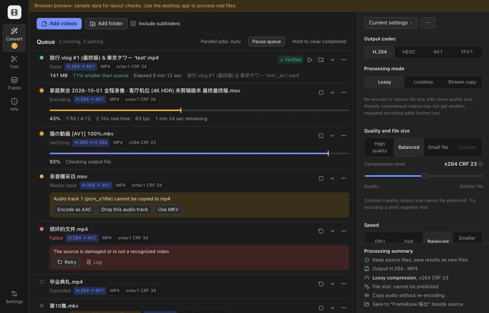
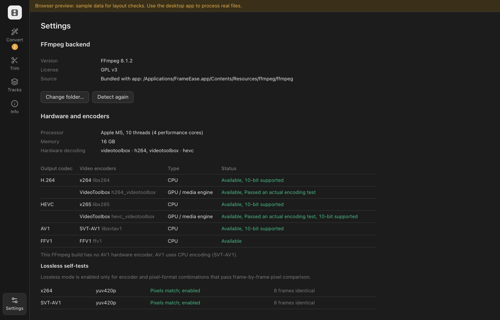

[English](README.md) | 简体中文


# FrameEase

面向 **macOS 和 Windows** 的本地视频压缩与转码工具，基于 FFmpeg。

批量压缩、片段试压、视频截取和轨道整理集中在同一个桌面应用中。原文件保持不变，输出通过校验后才标记为完成。

[](https://github.com/MarkYang44/FrameEase/actions/workflows/build.yml)

[](LICENSE)

[下载 v0.1.2](https://github.com/MarkYang44/FrameEase/releases/tag/v0.1.2) · [快速开始](#快速开始) · [开发](#开发) · [文档](#文档)

## 概览

FrameEase 将 H.264、HEVC、AV1 和 FFV1 处理流程与持久化批量队列结合。用户明确选择有损压缩、经过校验的无损重编码或流复制；不支持的组合会显示原因和可用的修正选项。

支持完整英文与简体中文界面、深浅色主题、键盘操作及减少动态效果。视频处理在本机完成。

## 界面预览

以下为当前界面的浏览器预览，使用合成队列数据，仅展示布局与语言支持，不代表编码性能，也不是原生窗口截图。

<table>
  <tr>
    <td width="50%"><strong>批量转码</strong><br><a href="docs/screenshots/en/convert.png"></a></td>
    <td width="50%"><strong>设置与编码能力</strong><br><a href="docs/screenshots/en/settings.png"></a></td>
  </tr>
</table>

## 核心功能

| 工作流 | 功能 |
| --- | --- |
| **压缩与转码** | H.264、HEVC、AV1；质量预设、编码器原生质量值、目标码率或体积，以及支持时的两遍编码。 |
| **无损重编码** | 仅开放通过自检的编码器与像素格式组合，完成后逐帧比对解码像素；FFV1 使用 MKV 存档。 |
| **流复制** | 不重编码地更换容器或选择轨道，通过数据哈希校验复制轨道。 |
| **试压** | 编码短片段、滑动对比画面，查看可用的 PSNR、SSIM、VMAF；体积外推仅代表所选片段。 |
| **截取与轨道工具** | 基于关键帧的快速截取、重编码精确截取，音频与字幕合并、单轨提取。 |
| **批量队列** | 文件、文件夹、拖放、可选递归扫描、独立设置快照、排序、暂停、取消、重试和重启恢复。 |
| **信息与预设** | 详细媒体信息、复制文本报告、内置预设及自定义预设导入导出。 |

输出先写入临时文件，校验后以不覆盖方式提交。中断任务从头重新处理；单个任务失败或结果 CSV 被占用不会阻断整个队列。

硬件编码与解码仅在实际运行测试通过后启用。可用编码器和滤镜取决于 FFmpeg 构建及硬件。

## 安装与兼容性

安装包位于 [GitHub Releases](https://github.com/MarkYang44/FrameEase/releases/latest)，每个版本附带 `SHA256SUMS.txt` 校验文件。开发构建仍可在成功的 [GitHub Actions 运行](https://github.com/MarkYang44/FrameEase/actions/workflows/build.yml)中下载。

| 平台 | 可用性与验证状态 |
| --- | --- |
| **macOS · Apple Silicon** | 已在本机开发与测试；CI 生成 `.app` 和 `.dmg`。最低系统版本由随包 FFmpeg 依赖决定，本机打包配置目前要求 macOS 26.0+。 |
| **Windows 10/11 · x64** | Windows CI 已通过核心测试及 NSIS/MSI 打包；实体 Windows 桌面验证仍待完成。需要 WebView2，缺失时安装程序提供安装入口。 |
| **macOS · Intel** | 当前 CI 不提供安装包，尚未实机验证；从源码构建需要兼容的 Intel 版 FFmpeg。 |

Windows 免安装版下载 `FrameEase_<版本>_windows-x64-portable.zip`，**完整解压**后双击 **FrameEase.exe**。请保留程序旁的 `ffmpeg` 文件夹。ZIP 已包含 FFmpeg 及其 DLL，使用系统已有的 WebView2 Runtime；设置和队列仍保存在当前用户的应用数据目录，与安装版一致。详见[免安装包说明](docs/WINDOWS_PORTABLE.txt)。

macOS 打开 DMG 后将 FrameEase 拖入 Applications；Windows 使用 `.exe` 安装到当前用户，或使用 `.msi` 按机器安装。使用 bundle 配置构建的安装包包含 FFmpeg。

应用外壳配置的 macOS 下限为 11.0，**不代表附带较新 FFmpeg 的安装包支持此版本**。CI 会依据随包可执行文件声明实际下限。详见[测试与平台说明](docs/TESTING.md)。

### 首次启动

安装包未使用付费开发者证书签名。macOS 首次启动被拦截后，可在“系统设置 → 隐私与安全性”中选择“仍要打开”；Windows SmartScreen 可能提供“更多信息 → 仍要运行”。未安装 WebView2 的 Windows 电脑需要联网安装该运行时。

## 快速开始

1. 启动 FrameEase，等待检测 FFmpeg 与编码能力。
2. 添加视频、文件夹，或将其拖入窗口。
3. 在右侧选择输出编码、处理方式、画质及保存位置。
4. 处理兼容性提示；批量运行前可先“试压”一小段对比效果。
5. 点击“开始处理”，校验完成后打开结果或在文件夹中显示。

在 **设置 → 外观 → 语言** 切换中英文。“截取”“封装”“信息”分别提供其他工具。

| 快捷键 | 操作 |
| --- | --- |
| `⌘/Ctrl + O` | 添加视频 |
| `⌘/Ctrl + Shift + O` | 添加文件夹 |
| `⌘/Ctrl + ,` | 打开设置 |
| `⌘/Ctrl + Enter` | 在转码页开始处理待处理文件 |

## 处理限制

- 有损编码可能增大体积，并引入代际损失。无损重编码通常明显增大体积，也不能恢复源文件已经丢失的细节。
- 未实现 HDR→SDR 色调映射；不支持的 HDR 组合会被拒绝。杜比视界重编码需确认丢失动态元数据，Profile 5 不支持。
- 文字字幕烧录需要 libass。编码器、硬件加速、滤镜和指标的可用性随 FFmpeg 构建而异。
- 快速截取从关键帧开始；中断任务不支持从中间帧续编。
- SVT-AV1 在高并发下可能停滞；线程限制、停滞检测和一次自动重试能缓解，但不能消除上游问题。

## 隐私

视频在本机处理，不会自动上传媒体。队列、设置、预览、日志和结果 CSV 保存在本地；报告与日志可能包含文件路径及媒体元数据。

## 开发

需要 **Node.js 22.12+**、**Rust 1.89+** 和 FFmpeg/ffprobe。原生构建还需 macOS 的 Xcode Command Line Tools，或 Windows 的 MSVC Build Tools 与 WebView2。

```bash
npm ci
npm run app:dev
```

后端查找顺序：自定义目录 → 随包资源 → 可执行文件旁的便携目录 → 系统 PATH。可在设置中更换后端。

```bash
npm test                 # 翻译与格式化回归
npm run typecheck
npm run build
npm run core:test        # Rust 测试，使用 FFmpeg 合成素材
npx playwright install chromium
npm run test:ui          # 浏览器布局与语言回归
```

浏览器测试使用带明确标识的模拟预览，不验证编码正确性。`npm run dev` 启动同一预览。`npm run app:dev:bridge` 启动可选调试桥接，通过 `http://localhost:1420/?bridge` 驱动真实调试后端；发布构建不包含此功能。

<details>
<summary>构建桌面安装包</summary>

macOS，先准备兼容的 FFmpeg：

```bash
npm run ffmpeg:bundle
npm run app:build
```

Windows PowerShell：

```powershell
pwsh ./scripts/fetch-ffmpeg-windows.ps1
$env:STATIC_VCRUNTIME = "true"
npm run app:build
npm run windows:portable
```

产物位于 `target/release/bundle/`。打包时请确保 macOS 最低版本与附带依赖一致。

推送与应用版本一致的 `v*` 标签后，工作流会构建双平台安装包和 Windows 免安装 ZIP、验证免安装包启动并检查安装包内容，并附带 SHA-256 校验和及 `docs/releases/<tag>.md` 发布说明。

图标原图为 `assets/app-icon.png`，运行 `npm run icons` 可重新生成桌面 PNG、ICNS、ICO 与 Windows 磁贴资源。

</details>

## 文档

| 文档 | 内容 |
| --- | --- |
| [架构](docs/ARCHITECTURE.md) | Rust 引擎、命令桥接、界面职责和输出安全 |
| [测试](docs/TESTING.md) | 测试命令、历史结果、平台验证及限制 |
| [第三方许可](docs/THIRD_PARTY_LICENSES.md) | FFmpeg 及随包依赖的许可说明 |

## 许可

FrameEase 源码采用 [MIT](LICENSE) 许可。FFmpeg 及其库遵循各自许可；启用 GPL 组件的随包构建按相应条款分发。详见[第三方许可](docs/THIRD_PARTY_LICENSES.md)。
